# Resomix design system

**The system of record is v3 "calm", Studio (dark) only.** New and changed screens on every surface (the app, the beta and resomix.com) follow it:

- [The professional standard](docs/professional-standard.md): ten rules and the pre-ship checklist every screen must pass.
- [The v3 guidelines](docs/guidelines-v3.md): principles, the product frame, colour, type, space, states and writing.
- [The v3 tokens](tokens/v3/tokens.json), generated as [`tokens/v3/tokens.css`](tokens/v3/tokens.css): `--ds-*` custom properties in rem, and `.ds-*` classes for every type style.
- `npm run check` tests every v3 text, edge, status and data colour on every ground.

The rest of this page documents the **live app as it is today** (the `--rx-*` layer): the fonts, colours, spacing, patterns and components shown on [`/lab/design`](https://staging-frontend.resomix.com/lab/design), plus the tokens, icons and contrast check that keep them consistent while screens move to v3. The [v3 guidelines](docs/guidelines-v3.md#moving-from-v2-brutal) map each old token to its v3 name.

> The screenshots and values below were taken from staging on 2026-10-31. Four colours have since been fixed for contrast in [`tokens/rx.json`](tokens/rx.json); they are marked **fixed** in the tables. See [the contrast audit](docs/contrast-audit.md).


<details>
<summary>The brand itself (logo, safe space and brand palette) lives in the brand guidelines. This page is the current product UI.</summary>

See also [the v3 "calm" direction](docs/guidelines-v3.md) and its [tokens](tokens/v3/tokens.json).
</details>

## On this page

1. [Colours](#colours)
2. [Type](#type)
3. [Spacing and layout](#spacing-and-layout)
4. [Surfaces, lines and marks](#surfaces-lines-and-marks)
5. [Buttons and fields](#buttons-and-fields)
6. [Sonic Discovery](#sonic-discovery)
7. [Feedback](#feedback)
8. [States](#states)
9. [Motion](#motion)
10. [Icons](#icons)
11. [Where it lives](#where-it-lives)
12. [Tokens, contrast and tooling](#tokens-contrast-and-tooling)

---

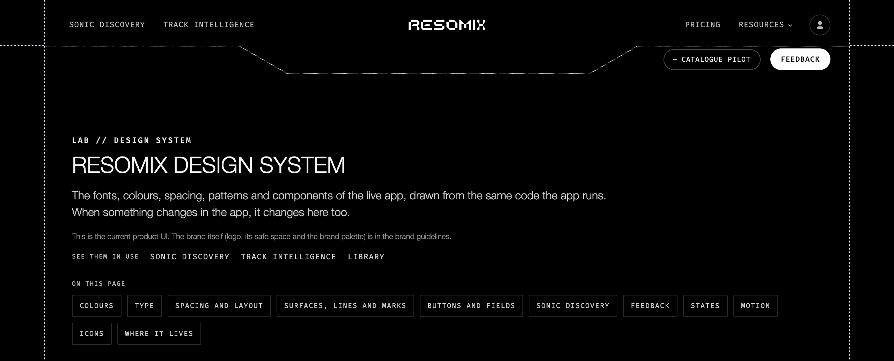

See them in use: **Sonic Discovery**, **Track Intelligence**, **Library**.

## Colours

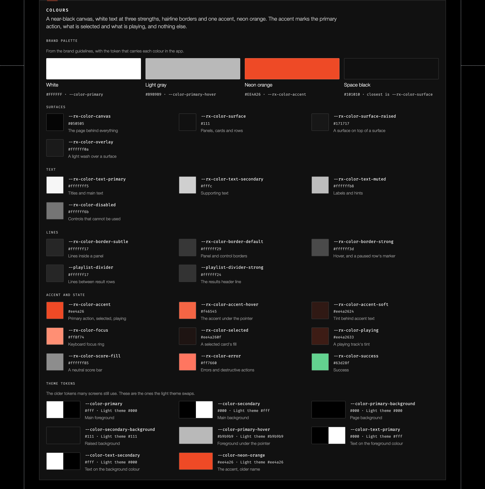

A near-black canvas, white text at three strengths, hairline borders and one accent, neon orange. The accent marks the primary action, what is selected and what is playing, and nothing else.

### Brand palette

From the brand guidelines, with the token that carries each colour in the app.

| Colour | Value | Token in the app |
|---|---|---|
| White | `#FFFFFF` | `--color-primary` |
| Light gray | `#B9B9B9` | `--color-primary-hover` |
| Neon orange | `#EE4A26` | `--rx-color-accent` |
| Space black | `#101010` | closest is `--rx-color-surface` |

### Surfaces

| Token | Value | Use |
|---|---|---|
| `--rx-color-canvas` | `#050505` | The page behind everything |
| `--rx-color-surface` | `#111` | Panels, cards and rows |
| `--rx-color-surface-raised` | `#171717` | A surface on top of a surface |
| `--rx-color-overlay` | `#ffffff0a` | A light wash over a surface |

### Text

| Token | Value | Use |
|---|---|---|
| `--rx-color-text-primary` | `#fffffff5` | Titles and main text |
| `--rx-color-text-secondary` | `#fffc` | Supporting text |
| `--rx-color-text-muted` | `#ffffffb8` | Labels and hints |
| `--rx-color-disabled` | `#ffffff6b` → **fixed** `#ffffff80` | Controls that cannot be used |

### Lines

| Token | Value | Use |
|---|---|---|
| `--rx-color-border-subtle` | `#ffffff17` | Lines inside a panel (decorative) |
| `--rx-color-border-default` | `#ffffff29` | Panel borders (decorative) |
| `--rx-color-border-control` | **new** `#ffffff66` | Borders of controls: inputs, secondary buttons (3:1) |
| `--rx-color-border-strong` | `#ffffff3d` → **fixed** `#ffffff99` | Hover, and a paused row's marker |
| `--playlist-divider` | `#ffffff17` | Lines between result rows |
| `--playlist-divider-strong` | `#ffffff24` | The results header line |

### Accent and state

| Token | Value | Use |
|---|---|---|
| `--rx-color-accent` | `#ee4a26` | Primary action, selected, playing |
| `--rx-color-accent-hover` | `#f46545` | The accent under the pointer |
| `--rx-color-accent-text` | **new** `#ff7a5c` | Small orange text (Selected tag, rank, separators) |
| `--rx-color-accent-soft` | `#ee4a2624` | Tint behind accent text |
| `--rx-color-on-accent` | **new** `#050505` | Text on accent fills |
| `--rx-color-focus` | `#ff8f74` | Keyboard focus ring |
| `--rx-color-selected` | `#ee4a260f` | A selected card's fill |
| `--rx-color-playing` | `#ee4a2633` | A playing track's tint |
| `--rx-color-score-fill` | `#ffffff85` | A neutral score bar |
| `--rx-color-error` | `#ff7660` | Errors and destructive actions |
| `--rx-color-success` | `#63d28f` | Success |

### Theme tokens

The older tokens many screens still use. These are the ones the light theme swaps.

| Token | Dark | Light theme | Use |
|---|---|---|---|
| `--color-primary` | `#fff` | `#000` | Main foreground |
| `--color-secondary` | `#000` | `#fff` | Main background |
| `--color-primary-background` | `#000` | `#000` → **fixed** `#f6f6f4` | Page background |
| `--color-secondary-background` | `#111` | `#111` → **fixed** `#f0f0ee` | Raised background |
| `--color-primary-hover` | `#b9b9b9` | `#b9b9b9` | Foreground under the pointer |
| `--color-text-primary` | `#000` | `#fff` | Text on the foreground colour |
| `--color-text-secondary` | `#fff` | `#000` | Text on the background colour |
| `--color-neon-orange` | `#ee4a26` | `#ee4a26` | The accent, older name |

## Type

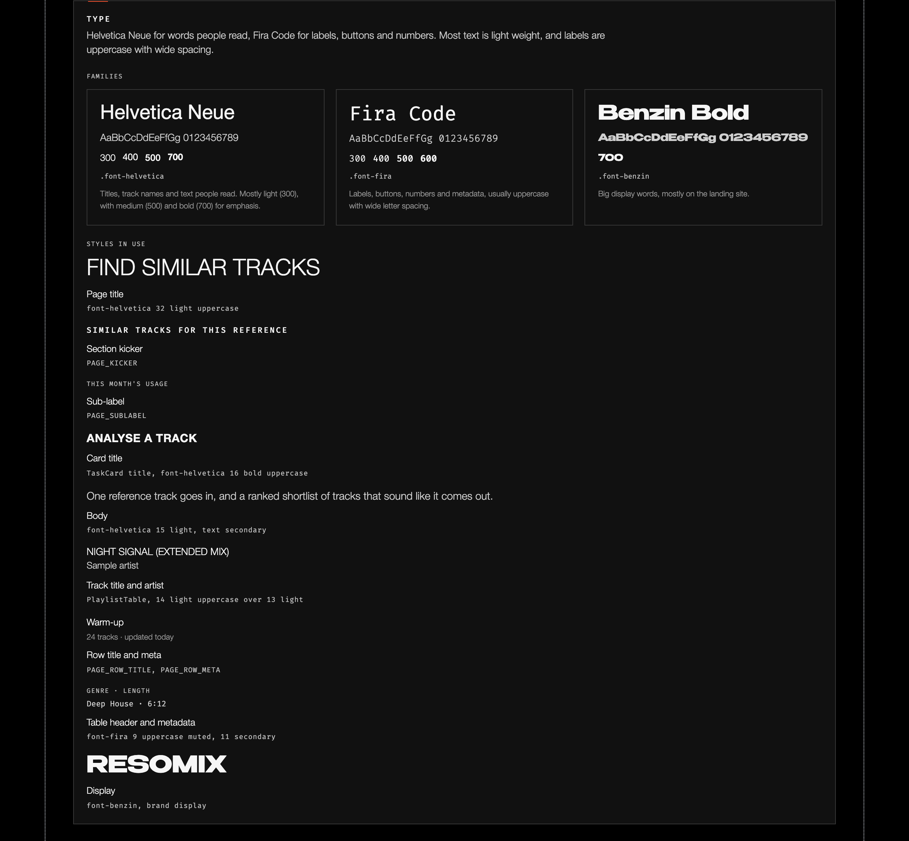

Helvetica Neue for words people read, Fira Code for labels, buttons and numbers. Most text is light weight, and labels are uppercase with wide spacing.

### Families

| Family | Weights | Class | Use |
|---|---|---|---|
| Helvetica Neue | 300, 400, 500, 700 | `.font-helvetica` | Titles, track names and text people read. Mostly light (300), with medium (500) and bold (700) for emphasis. |
| Fira Code | 300, 400, 500, 600 | `.font-fira` | Labels, buttons, numbers and metadata, usually uppercase with wide letter spacing. |
| Benzin Bold | 700 | `.font-benzin` | Big display words, mostly on the landing site. |

### Styles in use

| Sample | Style | Defined as |
|---|---|---|
| FIND SIMILAR TRACKS | Page title | `font-helvetica` 32 light uppercase |
| SIMILAR TRACKS FOR THIS REFERENCE | Section kicker | `PAGE_KICKER` |
| THIS MONTH'S USAGE | Sub-label | `PAGE_SUBLABEL` |
| ANALYSE A TRACK | Card title | TaskCard title, `font-helvetica` 16 bold uppercase |
| One reference track goes in, and a ranked shortlist of tracks that sound like it comes out. | Body | `font-helvetica` 15 light, text secondary |
| NIGHT SIGNAL (EXTENDED MIX) / Sample artist | Track title and artist | PlaylistTable, 14 light uppercase over 13 light |
| Warm-up / 24 tracks · updated today | Row title and meta | `PAGE_ROW_TITLE`, `PAGE_ROW_META` |
| GENRE · LENGTH / Deep House · 6:12 | Table header and metadata | `font-fira` 9 uppercase muted, 11 secondary |
| RESOMIX | Display | `font-benzin`, brand display |

## Spacing and layout

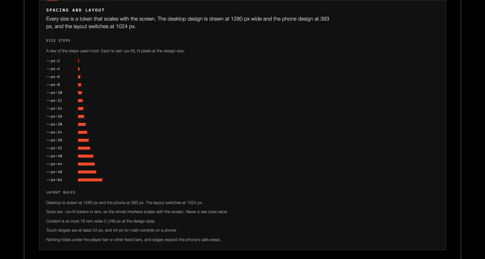

Every size is a token that scales with the screen. The desktop design is drawn at 1280 px wide and the phone design at 393 px, and the layout switches at 1024 px.

**Size steps.** A few of the steps used most. Each is `var(--px-N)`, N pixels at the design size: `--px-2`, `--px-4`, `--px-6`, `--px-8`, `--px-10`, `--px-12`, `--px-14`, `--px-16`, `--px-20`, `--px-24`, `--px-28`, `--px-32`, `--px-40`, `--px-44`, `--px-48`, `--px-64`. All 322 steps are in [`tokens/pixels.css`](tokens/pixels.css).

**Layout rules**

- Desktop is drawn at 1280 px and the phone at 393 px. The layout switches at 1024 px.
- Sizes are `--px-N` tokens in rem, so the whole interface scales with the screen. Never a raw pixel value. The root size is `clamp(12.8px, 1.25vw, 16px)` on desktop and `clamp(10px, 4.07vw, 26px)` below 1024 px.
- Content is at most 78 rem wide (1,248 px at the design size).
- Touch targets are at least 24 px, and 44 px for main controls on a phone.
- Nothing hides under the player bar or other fixed bars, and edges respect the phone's safe areas.

## Surfaces, lines and marks

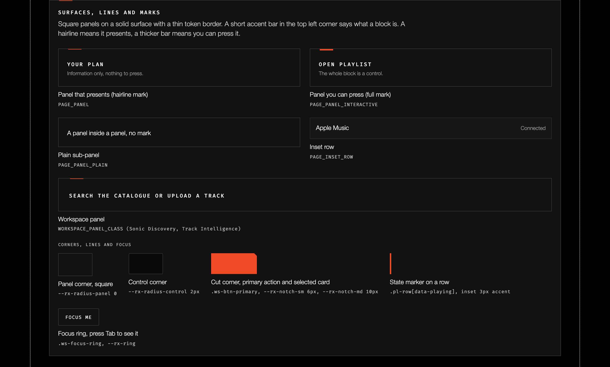

Square panels on a solid surface with a thin token border. A short accent bar in the top left corner says what a block is. A hairline means it presents, a thicker bar means you can press it.

| Example | Pattern | Defined as |
|---|---|---|
| YOUR PLAN, "Information only, nothing to press." | Panel that presents (hairline mark) | `PAGE_PANEL` |
| OPEN PLAYLIST, "The whole block is a control." | Panel you can press (full mark) | `PAGE_PANEL_INTERACTIVE` |
| A panel inside a panel, no mark | Plain sub-panel | `PAGE_PANEL_PLAIN` |
| Apple Music · Connected | Inset row | `PAGE_INSET_ROW` |
| SEARCH THE CATALOGUE OR UPLOAD A TRACK | Workspace panel | `WORKSPACE_PANEL_CLASS` (Sonic Discovery, Track Intelligence) |

**Corners, lines and focus**

| Part | Value |
|---|---|
| Panel corner, square | `--rx-radius-panel` 0 |
| Control corner | `--rx-radius-control` 2px |
| Cut corner, primary action and selected card | `.ws-btn-primary`, `--rx-notch-sm` 6px, `--rx-notch-md` 10px |
| State marker on a row | `.pl-row[data-playing]`, inset 3px accent |
| Focus ring (press Tab to see it) | `.ws-focus-ring`, `--rx-ring` = `0 0 0 1px #050505f2, 0 0 0 3px #ff8f74eb` |

## Buttons and fields

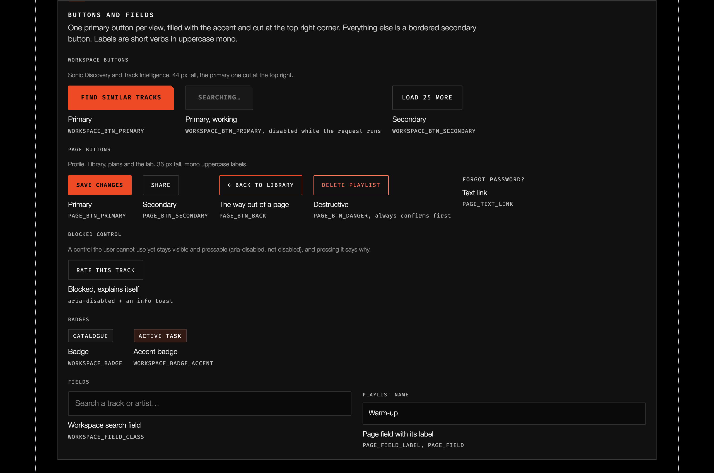

One primary button per view, filled with the accent and cut at the top right corner. Everything else is a bordered secondary button. Labels are short verbs in uppercase mono.

**Workspace buttons.** Sonic Discovery and Track Intelligence. 44 px tall, the primary one cut at the top right.

| Label | Kind | Defined as |
|---|---|---|
| FIND SIMILAR TRACKS | Primary | `WORKSPACE_BTN_PRIMARY` |
| SEARCHING… | Primary, working | `WORKSPACE_BTN_PRIMARY`, disabled while the request runs |
| LOAD 25 MORE | Secondary | `WORKSPACE_BTN_SECONDARY` |

**Page buttons.** Profile, Library, plans and the lab. 36 px tall, mono uppercase labels.

| Label | Kind | Defined as |
|---|---|---|
| SAVE CHANGES | Primary | `PAGE_BTN_PRIMARY` |
| SHARE | Secondary | `PAGE_BTN_SECONDARY` |
| ← BACK TO LIBRARY | The way out of a page | `PAGE_BTN_BACK` |
| DELETE PLAYLIST | Destructive | `PAGE_BTN_DANGER`, always confirms first |
| FORGOT PASSWORD? | Text link | `PAGE_TEXT_LINK` |

**Blocked control.** A control the user cannot use yet stays visible and pressable (`aria-disabled`, not `disabled`), and pressing it says why. Example: RATE THIS TRACK, `aria-disabled` plus an info toast.

**Badges.** CATALOGUE (`WORKSPACE_BADGE`), ACTIVE TASK (`WORKSPACE_BADGE_ACCENT`).

**Fields.** "Search a track or artist" (`WORKSPACE_FIELD_CLASS`); PLAYLIST NAME, a page field with its label (`PAGE_FIELD_LABEL`, `PAGE_FIELD`).

## Sonic Discovery

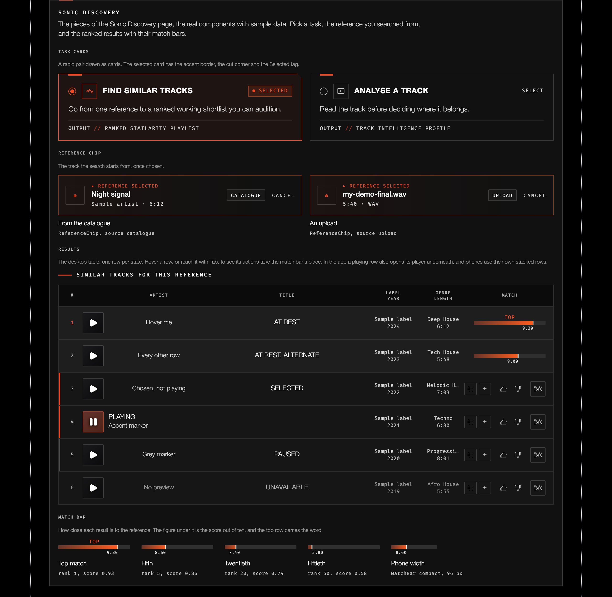

The pieces of the Sonic Discovery page, the real components with sample data. Pick a task, the reference you searched from, and the ranked results with their match bars.

**Task cards.** A radio pair drawn as cards. The selected card has the accent border, the cut corner and the Selected tag.

| Card | State | Copy | Output |
|---|---|---|---|
| FIND SIMILAR TRACKS | Selected | Go from one reference to a ranked working shortlist you can audition. | RANKED SIMILARITY PLAYLIST |
| ANALYSE A TRACK | Select | Read the track before deciding where it belongs. | TRACK INTELLIGENCE PROFILE |

**Reference chip.** The track the search starts from, once chosen: "Reference selected", the title, then artist and length, a source badge and Cancel. From the catalogue (`ReferenceChip`, source catalogue: Night signal, Sample artist · 6:12) or an upload (source upload: my-demo-final.wav, 5:40 · WAV).

**Results.** The desktop table, one row per state. Hover a row, or reach it with Tab, to see its actions take the match bar's place. In the app a playing row also opens its player underneath, and phones use their own stacked rows. Columns: #, Artist, Title, Label, Year, Genre, Length, Match.

| # | Row | State | Genre | Length | Match |
|---|---|---|---|---|---|
| 1 | Hover me | At rest | Deep House | 6:12 | TOP 9.30 |
| 2 | Every other row | At rest, alternate | Tech House | 5:48 | 9.00 |
| 3 | Chosen, not playing | Selected | Melodic House | 7:03 | 8.70 |
| 4 | Accent marker | Playing | Techno | 6:30 | 8.40 |
| 5 | Grey marker | Paused | Progressive House | 8:01 | 8.10 |
| 6 | No preview | Unavailable | Afro House | 5:55 | 7.70 |

**Match bar.** How close each result is to the reference. The figure under it is the score out of ten, and the top row carries the word.

| Shown | Meaning |
|---|---|
| TOP 9.30 | Top match, rank 1, score 0.93 |
| 8.60 | Fifth, rank 5, score 0.86 |
| 7.40 | Twentieth, rank 20, score 0.74 |
| 5.80 | Fiftieth, rank 50, score 0.58 |
| 8.60 | Phone width, `MatchBar` compact, 96 px |

## Feedback

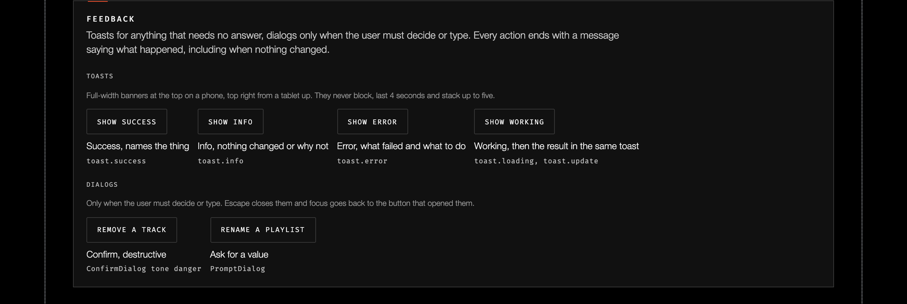

Toasts for anything that needs no answer, dialogs only when the user must decide or type. Every action ends with a message saying what happened, including when nothing changed.

**Toasts.** Full-width banners at the top on a phone, top right from a tablet up. They never block, last 4 seconds and stack up to five.

| Kind | Rule | Call |
|---|---|---|
| Success | Names the thing | `toast.success` |
| Info | Nothing changed, or why not | `toast.info` |
| Error | What failed and what to do | `toast.error` |
| Working | Then the result in the same toast | `toast.loading`, `toast.update` |

**Dialogs.** Only when the user must decide or type. Escape closes them and focus goes back to the button that opened them.

| Example | Kind | Component |
|---|---|---|
| REMOVE A TRACK | Confirm, destructive | `ConfirmDialog` tone danger |
| RENAME A PLAYLIST | Ask for a value | `PromptDialog` |

## States

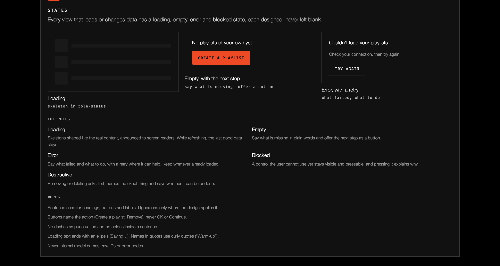

Every view that loads or changes data has a loading, empty, error and blocked state, each designed, never left blank.

| State | Example | Rule |
|---|---|---|
| Loading | "Loading your playlists…" (skeleton in `role=status`) | Skeletons shaped like the real content, announced to screen readers. While refreshing, the last good data stays. |
| Empty | "No playlists of your own yet." + CREATE A PLAYLIST | Say what is missing in plain words and offer the next step as a button. |
| Error | "Couldn't load your playlists. Check your connection, then try again." + TRY AGAIN | Say what failed and what to do, with a retry where it can help. Keep whatever already loaded. |
| Blocked | — | A control the user cannot use yet stays visible and pressable, and pressing it explains why. |
| Destructive | — | Removing or deleting asks first, names the exact thing and says whether it can be undone. |

**Words**

- Sentence case for headings, buttons and labels. Uppercase only where the design applies it.
- Buttons name the action (Create a playlist, Remove), never OK or Continue.
- No dashes as punctuation and no colons inside a sentence.
- Loading text ends with an ellipsis (Saving…). Names in quotes use curly quotes (“Warm-up”).
- Never internal model names, raw IDs or error codes.

## Motion

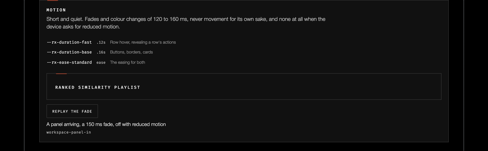

Short and quiet. Fades and colour changes of 120 to 160 ms, never movement for its own sake, and none at all when the device asks for reduced motion.

| Token | Value | Use |
|---|---|---|
| `--rx-duration-fast` | `.12s` | Row hover, revealing a row's actions |
| `--rx-duration-base` | `.16s` | Buttons, borders, cards |
| `--rx-ease-standard` | `ease` | The easing for both |
| `workspace-panel-in` | 150 ms fade | A panel arriving, off with reduced motion |

## Icons

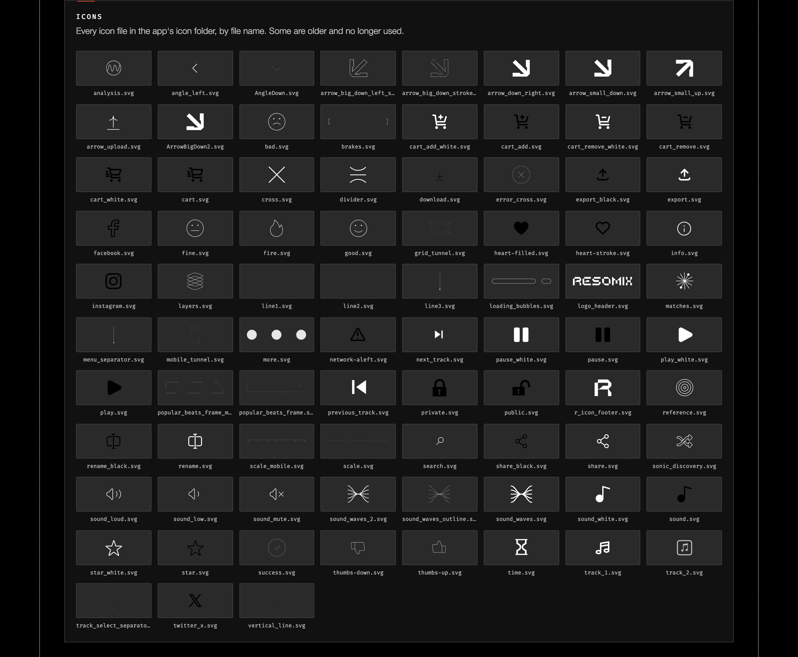

Every icon file in the app's icon folder, by file name. Some are older and no longer used. All 83 are in [`assets/icons/`](assets/icons). Most are drawn in white for the dark UI, so they may look blank on GitHub's light theme.

<details>
<summary>All 83 icon files</summary>

| Icon | Icon | Icon | Icon |
|---|---|---|---|
| [`analysis.svg`](assets/icons/analysis.svg) | [`angle_left.svg`](assets/icons/angle_left.svg) | [`AngleDown.svg`](assets/icons/AngleDown.svg) | [`arrow_big_down_left_stroke.svg`](assets/icons/arrow_big_down_left_stroke.svg) |
| [`arrow_big_down_stroke.svg`](assets/icons/arrow_big_down_stroke.svg) | [`arrow_down_right.svg`](assets/icons/arrow_down_right.svg) | [`arrow_small_down.svg`](assets/icons/arrow_small_down.svg) | [`arrow_small_up.svg`](assets/icons/arrow_small_up.svg) |
| [`arrow_upload.svg`](assets/icons/arrow_upload.svg) | [`ArrowBigDown2.svg`](assets/icons/ArrowBigDown2.svg) | [`bad.svg`](assets/icons/bad.svg) | [`brakes.svg`](assets/icons/brakes.svg) |
| [`cart_add_white.svg`](assets/icons/cart_add_white.svg) | [`cart_add.svg`](assets/icons/cart_add.svg) | [`cart_remove_white.svg`](assets/icons/cart_remove_white.svg) | [`cart_remove.svg`](assets/icons/cart_remove.svg) |
| [`cart_white.svg`](assets/icons/cart_white.svg) | [`cart.svg`](assets/icons/cart.svg) | [`cross.svg`](assets/icons/cross.svg) | [`divider.svg`](assets/icons/divider.svg) |
| [`download.svg`](assets/icons/download.svg) | [`error_cross.svg`](assets/icons/error_cross.svg) | [`export_black.svg`](assets/icons/export_black.svg) | [`export.svg`](assets/icons/export.svg) |
| [`facebook.svg`](assets/icons/facebook.svg) | [`fine.svg`](assets/icons/fine.svg) | [`fire.svg`](assets/icons/fire.svg) | [`good.svg`](assets/icons/good.svg) |
| [`grid_tunnel.svg`](assets/icons/grid_tunnel.svg) | [`heart-filled.svg`](assets/icons/heart-filled.svg) | [`heart-stroke.svg`](assets/icons/heart-stroke.svg) | [`info.svg`](assets/icons/info.svg) |
| [`instagram.svg`](assets/icons/instagram.svg) | [`layers.svg`](assets/icons/layers.svg) | [`line1.svg`](assets/icons/line1.svg) | [`line2.svg`](assets/icons/line2.svg) |
| [`line3.svg`](assets/icons/line3.svg) | [`loading_bubbles.svg`](assets/icons/loading_bubbles.svg) | [`logo_header.svg`](assets/icons/logo_header.svg) | [`matches.svg`](assets/icons/matches.svg) |
| [`menu_separator.svg`](assets/icons/menu_separator.svg) | [`mobile_tunnel.svg`](assets/icons/mobile_tunnel.svg) | [`more.svg`](assets/icons/more.svg) | [`network-aleft.svg`](assets/icons/network-aleft.svg) |
| [`next_track.svg`](assets/icons/next_track.svg) | [`pause_white.svg`](assets/icons/pause_white.svg) | [`pause.svg`](assets/icons/pause.svg) | [`play_white.svg`](assets/icons/play_white.svg) |
| [`play.svg`](assets/icons/play.svg) | [`popular_beats_frame_mobile.svg`](assets/icons/popular_beats_frame_mobile.svg) | [`popular_beats_frame.svg`](assets/icons/popular_beats_frame.svg) | [`previous_track.svg`](assets/icons/previous_track.svg) |
| [`private.svg`](assets/icons/private.svg) | [`public.svg`](assets/icons/public.svg) | [`r_icon_footer.svg`](assets/icons/r_icon_footer.svg) | [`reference.svg`](assets/icons/reference.svg) |
| [`rename_black.svg`](assets/icons/rename_black.svg) | [`rename.svg`](assets/icons/rename.svg) | [`scale_mobile.svg`](assets/icons/scale_mobile.svg) | [`scale.svg`](assets/icons/scale.svg) |
| [`search.svg`](assets/icons/search.svg) | [`share_black.svg`](assets/icons/share_black.svg) | [`share.svg`](assets/icons/share.svg) | [`sonic_discovery.svg`](assets/icons/sonic_discovery.svg) |
| [`sound_loud.svg`](assets/icons/sound_loud.svg) | [`sound_low.svg`](assets/icons/sound_low.svg) | [`sound_mute.svg`](assets/icons/sound_mute.svg) | [`sound_waves_2.svg`](assets/icons/sound_waves_2.svg) |
| [`sound_waves_outline.svg`](assets/icons/sound_waves_outline.svg) | [`sound_waves.svg`](assets/icons/sound_waves.svg) | [`sound_white.svg`](assets/icons/sound_white.svg) | [`sound.svg`](assets/icons/sound.svg) |
| [`star_white.svg`](assets/icons/star_white.svg) | [`star.svg`](assets/icons/star.svg) | [`success.svg`](assets/icons/success.svg) | [`thumbs-down.svg`](assets/icons/thumbs-down.svg) |
| [`thumbs-up.svg`](assets/icons/thumbs-up.svg) | [`time.svg`](assets/icons/time.svg) | [`track_1.svg`](assets/icons/track_1.svg) | [`track_2.svg`](assets/icons/track_2.svg) |
| [`track_select_separator_line.svg`](assets/icons/track_select_separator_line.svg) | [`twitter_x.svg`](assets/icons/twitter_x.svg) | [`vertical_line.svg`](assets/icons/vertical_line.svg) |   |

</details>

## Where it lives

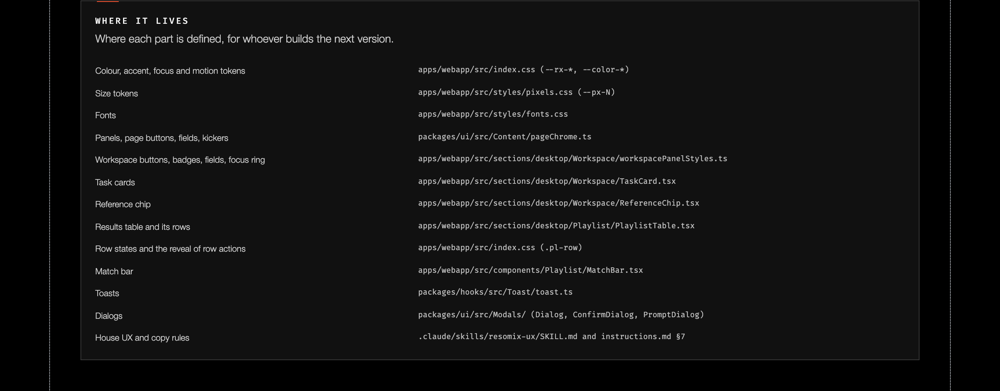

Where each part is defined, for whoever builds the next version.

| Part | File |
|---|---|
| Colour, accent, focus and motion tokens | `apps/webapp/src/index.css` (`--rx-*`, `--color-*`) |
| Size tokens | `apps/webapp/src/styles/pixels.css` (`--px-N`) |
| Fonts | `apps/webapp/src/styles/fonts.css` |
| Panels, page buttons, fields, kickers | `packages/ui/src/Content/pageChrome.ts` |
| Workspace buttons, badges, fields, focus ring | `apps/webapp/src/sections/desktop/Workspace/workspacePanelStyles.ts` |
| Task cards | `apps/webapp/src/sections/desktop/Workspace/TaskCard.tsx` |
| Reference chip | `apps/webapp/src/sections/desktop/Workspace/ReferenceChip.tsx` |
| Results table and its rows | `apps/webapp/src/sections/desktop/Playlist/PlaylistTable.tsx` |
| Row states and the reveal of row actions | `apps/webapp/src/index.css` (`.pl-row`) |
| Match bar | `apps/webapp/src/components/Playlist/MatchBar.tsx` |
| Toasts | `packages/hooks/src/Toast/toast.ts` |
| Dialogs | `packages/ui/src/Modals/` (`Dialog`, `ConfirmDialog`, `PromptDialog`) |
| House UX and copy rules | `.claude/skills/resomix-ux/SKILL.md` and `instructions.md` §7 |

---

## Tokens, contrast and tooling

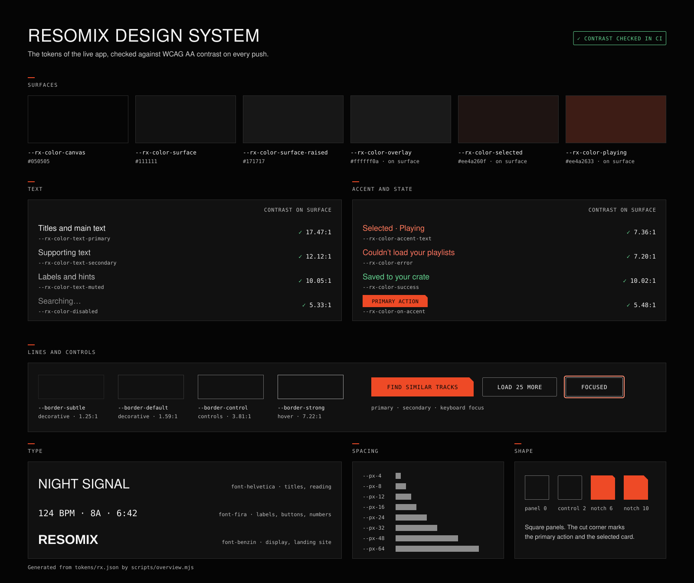

The repo keeps two layers:

| Layer | What it is | Files |
|---|---|---|
| **v3 "calm" (system of record)** | Semantic tokens for the one theme, Studio (dark), plus the guidelines and the professional standard | `tokens/v3/tokens.json` (source), `tokens/v3/tokens.css`, `docs/guidelines-v3.md`, `docs/professional-standard.md` |
| **Live app (`--rx-*`, legacy)** | The tokens above, with the contrast fixes applied. Kept while screens move to v3 | `tokens/rx.json` (source), `tokens/rx.css`, `tokens/pixels.css` |

```bash
npm run build   # regenerate tokens/v3/tokens.css, tokens/rx.css, tokens/pixels.css and docs/overview.svg
npm run check   # WCAG contrast check: every v3 pair on every Studio ground, and the live layer's pairs
npm test        # both, and fails if a generated file is out of date
npm run capture # retake docs/lab-design/ screenshots and assets/icons/ from /lab/design (needs Chrome)
```

To change a token, edit `tokens/rx.json`, run `npm test`, and commit the JSON with the generated files. CI runs the same check on every push and pull request.

In the webapp, swap the `--rx-*` and `--color-*` block in `apps/webapp/src/index.css` for `tokens/rx.css`, and the `--px-*` block in `styles/pixels.css` for `tokens/pixels.css`.

**Contrast rules**

- Text: 4.5:1 on every ground it can sit on, including the selected and playing tints.
- Edges of things people operate, the focus ring and chart marks: 3:1.
- `--rx-color-accent` is for fills, bars and markers. Small orange text uses `--rx-color-accent-text`.
- `--rx-color-border-subtle`, `--rx-color-border-default` and the playlist dividers are decorative. Never use them as the only edge of a control; use `--rx-color-border-control`.

What changed and why: [docs/contrast-audit.md](docs/contrast-audit.md). Where each part lives: [docs/source-map.md](docs/source-map.md).

**Not in this repo**

- **Font files.** Helvetica Neue, Fira Code, Benzin and Auger Mono are served from the webapp's `/fonts`. Helvetica Neue and Benzin are licensed and Auger Mono is loaded as trial files, so only the families and fallbacks are recorded here.
- **Component code.** Panels, buttons, task cards, the results table and toasts live in the webapp and `packages/ui`.
- **Screenshots** in `docs/lab-design/` are a snapshot of staging. Retake them after the app changes.
